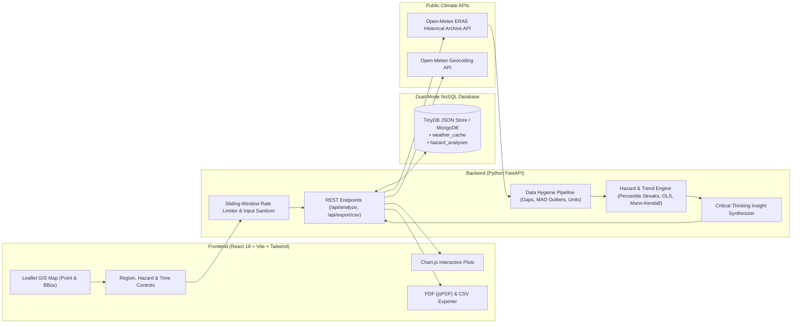

# Climate Hazard Trend Analyzer

**Full-Stack Developer Case Study — Dygnify Ventures Pvt Ltd**

[](https://climate-hazard-trend-analyzer-997p.onrender.com)
[](https://github.com/mattaparthisathwika-bit/Climate_Hazard_Trend_Analyzer)

- **Live Deployed Application**: [https://climate-hazard-trend-analyzer-997p.onrender.com](https://climate-hazard-trend-analyzer-997p.onrender.com)
- **Public GitHub Repository**: [https://github.com/mattaparthisathwika-bit/Climate_Hazard_Trend_Analyzer](https://github.com/mattaparthisathwika-bit/Climate_Hazard_Trend_Analyzer)

A full-stack climate intelligence web application that ingests and caches multi-decade historical daily weather data, cleans telemetry anomalies and gaps, detects extreme climate hazards (**Heatwaves**, **Heavy Rainfall**, and **Droughts / Dry Spells**), and visualizes long-term trends using interactive **Chart.js** time-series plots, **Leaflet GIS** spatial mapping, **Ordinary Least Squares (OLS) Linear Regression**, **Rolling Averages**, and the **Mann-Kendall Non-Parametric Trend Test**.

---

## 1. Key Features & Bonus Challenges Implemented

### Core Features
- **Flexible Geographic Region Selection**:
  - **Cities & States**: Curated presets across India and global climate zones (New Delhi, Mumbai, Bengaluru, Chennai, Rajasthan State, Maharashtra State, Phoenix, Madrid, Sydney, Tokyo, California) plus live worldwide **City/State Geocoding Search**.
  - **Custom Lat-Lon Bounding Box**: Define any regional bounding box (`min_lat`, `max_lat`, `min_lon`, `max_lon`). For large bounding boxes ($\ge 1.5^\circ$), the backend samples a representative multi-point spatial grid and aggregates daily observations.
  - **Interactive Coordinate Pinning**: Click anywhere on the interactive map to analyze any land location on Earth.
- **Climate Hazard Detection Engine (Heatwave Default + Multi-Hazard)**:
  - **Heatwave (Selected by Default)**: Detects streaks of $3+$ consecutive days where daily maximum temperature ($T_{\max}$) exceeds the regional $95\text{th}$ percentile (supports both fixed baseline percentile and dynamic 15-day rolling calendar percentile per WMO `CTX90pct`).
  - **Heavy Rainfall (`WMO R95p`)**: Detects extreme precipitation events where daily rainfall exceeds the $95\text{th}$ percentile of wet days ($\ge 1.0\text{ mm}$).
  - **Meteorological Drought (`WMO CDD`)**: Detects prolonged dry spells of $14+$ consecutive dry days ($\text{precipitation} < 1.0\text{ mm}$).
- **NoSQL Document Caching (`weather_cache` & `hazard_analyses`)**:
  - Dual-mode NoSQL layer using **TinyDB** (zero-config embedded JSON document database at `backend/data/climate_nosql_db.json`) by default, with automatic switchover to **MongoDB** (`pymongo`) when `MONGODB_URI` is set.
- **Interactive Visualizations & Honest Summary Insights**:
  - Generates natural-language headlines (e.g., *"Heatwaves have increased by 46.2% in New Delhi, India since 1990."*) paired with statistical significance checks and critical-thinking caveats.

### Bonus Challenges Completed
1. **Interactive Map UI (Leaflet / React-Leaflet)**: Dark-mode GIS map supporting click-to-pin coordinates, visual bounding-box rectangles, and sampled reanalysis grid markers.
2. **Advanced Statistical Trend Detection**: Combines **5-Year & 10-Year Rolling Averages**, **OLS Linear Regression** (slope/decade, $R^2$, $p$-value), and the **Non-Parametric Mann-Kendall Trend Test** ($Z$-score, Kendall's $\tau$, two-sided $p$-value, and **Theil-Sen robust median slope**).
3. **PDF & CSV Export of Insights**: One-click **CSV Export** (`/api/export/csv`) of annual series and regression trends, plus client-side **Executive PDF Report Generation** (`jsPDF` + `jspdf-autotable`) containing the headline insight, statistical test tables, decadal breakdown, and top extreme events catalog.

---

## 2. System Architecture



---

## 3. Setup Steps (Local Development)

### Prerequisites
- **Python 3.10+**
- **Node.js 18+ & npm**

### Step 1: Clone & Set Up the Python Backend
```powershell
# 1. Create and activate a Python virtual environment
python -m venv .venv
.\.venv\Scripts\Activate.ps1

# 2. Install backend dependencies
.\.venv\Scripts\pip install -r backend/requirements.txt

# 3. Run the automated backend test suite (pytest)
.\.venv\Scripts\python -m pytest backend/tests/test_api.py -v

# 4. Start the FastAPI server on http://127.0.0.1:8000
.\.venv\Scripts\uvicorn backend.main:app --host 127.0.0.1 --port 8000 --reload
```

### Step 2: Set Up & Run the React Frontend
Open a second terminal in the project root:
```powershell
cd frontend
npm install
npm run dev
```
Then open **http://localhost:5173** in your browser. (Or run `.\start.ps1` on Windows PowerShell to launch both servers automatically.)

---

## 4. Data Source(s) & Data Handling Methodology

### Primary Weather Data Source
- **Open-Meteo Historical Weather API (`https://archive-api.open-meteo.com/v1/archive`)**: Provides continuous daily gridded historical reanalysis observations from **ECMWF ERA5 / ERA5-Land** (`1940–Present`) at $\sim 9\text{--}25\text{ km}$ spatial resolution without requiring proprietary API keys.
- **Variables Ingested**: `temperature_2m_max`, `temperature_2m_min`, `temperature_2m_mean`, and `precipitation_sum`.
- **Offline Resilience**: If the host environment has no external internet access, `weather_client.py` includes a deterministic, latitude-calibrated climatological simulation fallback and transparently flags the data source in the UI.

### Data Cleaning & Hygiene Pipeline (`backend/data_processor.py`)
1. **Calendar Grid Re-indexing**: Deduplicates timestamps and re-indexes daily observations against a continuous calendar grid (`pd.date_range(freq="D")`) to expose missing dates.
2. **Physical Plausibility & Consistency Filtering**: Filters out corrupt sensor values outside WMO surface limits ($T_{\max} \notin [-85^\circ\text{C}, +60^\circ\text{C}]$, $\text{PRCP} \notin [0\text{ mm}, 1850\text{ mm}]$) and repairs inverted $T_{\min} > T_{\max}$ records.
3. **15-Day Rolling MAD Telemetry Spike Screening**: Identifies isolated single-day telemetry glitches that deviate by $> 6.5 \times \text{MAD}$ from the 15-day rolling median *and* jump $> 16^\circ\text{C}$ relative to both adjacent days, replacing glitches with the local rolling median while preserving genuine multi-day extreme weather fronts.
4. **Short-Gap Linear Interpolation**: Linearly interpolates short temperature gaps ($\le 3$ consecutive missing days). Longer gaps ($> 3$ days) are intentionally left as `NaN` so they never fabricate artificial multi-day heatwave streaks.
5. **Unit Normalization**: Supports both **Celsius (`°C`)** and **Fahrenheit (`°F`)** with consistent threshold and excess degree-day conversion.

---

## 5. Climate Hazard Logic & Statistical Trend Analysis

### Hazard Definitions (`backend/hazard_engine.py`)
- **Climatological Reference Baseline**: To prevent recent warming from artificially inflating the threshold and masking historical trends, the $95\text{th}$ percentile threshold is anchored to the reference baseline window (the first half of the selected period, up to 20 years), while also reporting the full-period percentile for comparison.
- **Heatwave (Default)**:
  - **Fixed Regional Percentile Mode**: $3+$ consecutive days (configurable $1\text{--}21$ days) where $T_{\max} > P_{95,\text{baseline}}$.
  - **Dynamic Calendar-Day Mode (`WMO CTX90pct`)**: $3+$ consecutive warm-season days where $T_{\max}$ exceeds the 15-day rolling calendar-day $95\text{th}$ percentile.
- **Heavy Rainfall (`WMO R95p`)**: $1+$ (or $N+$) consecutive days where daily precipitation exceeds the $95\text{th}$ percentile of wet days ($\text{PRCP} \ge 1.0\text{ mm}$).
- **Drought / Dry Spell (`WMO CDD`)**: Contiguous episodes of $14+$ consecutive dry days ($\text{PRCP} < 1.0\text{ mm}$).

### Trend Detection & Critical Thinking (`backend/hazard_engine.py` & `backend/insights_generator.py`)
- **Ordinary Least Squares (OLS) Linear Regression**: Computes parametric slope per year and per decade, $R^2$, standard error, and two-sided $p$-value.
- **Mann-Kendall Non-Parametric Trend Test & Sen's Slope**: Because annual extreme event counts are discrete and often right-skewed, parametric OLS can be sensitive to a single outlier year (e.g., an El Niño super-spike). We pair OLS with the distribution-free **Mann-Kendall test** ($S$-statistic with tie-group variance correction, $Z$-score, Kendall's $\tau$, and **Theil-Sen median slope**).
- **Honest Insight Synthesis**: Headline percentage changes compare the early multi-year window against the most recent multi-year window and automatically surface caveats when:
  1. The time range is shorter than the 30-year WMO standard climatological normal.
  2. The Mann-Kendall $p$-value exceeds $\alpha = 0.05$ (distinguishing statistically significant trends from inter-annual climate noise).
  3. The early baseline average is near zero (warning against small-denominator percentage inflation).

---

## 6. Assumptions & What We Would Improve With More Time

### Key Assumptions
1. **Baseline Reference Period**: When a user selects a custom time range (e.g., `1990–2020`), the first half of the period (`1990–2004`) serves as the local reference baseline for computing the percentile threshold unless a fixed 30-year WMO baseline (`1981–2010`) is pre-loaded.
2. **Bounding Box Spatial Aggregation**: To maintain fast interactive API response times ($< 2.5\text{s}$ uncached, $< 10\text{ms}$ cached) and respect public Open-Meteo rate limits, custom bounding boxes larger than $1.5^\circ \times 1.5^\circ$ are represented by a 3-point diagonal spatial transect (SW quadrant, centroid, NE quadrant) rather than downloading a dense 100-point netCDF raster.
3. **Daytime vs. Nighttime Heatwaves**: By default, heatwaves are evaluated on daily maximum temperature ($T_{\max}$) as specified in the case study brief (`3+ consecutive days with maximum temperature above the 95th percentile`).

### What We Would Improve With More Time
1. **Compound & Nighttime Heatwave Indices (`EHF` & Tropical Nights `TR20`)**: Incorporate daily minimum temperature ($T_{\min}$) and relative humidity (Wet-Bulb Globe Temperature / Apparent Temperature) to capture humid coastal heat stress and lack of nocturnal recovery.
2. **Standardized Precipitation-Evapotranspiration Index (`SPEI`)**: Enhance the Drought module from consecutive dry days (`CDD`) to multi-scalar water-balance drought (`SPEI-3`, `SPEI-12`) using `et0_fao_evapotranspiration`.
3. **Gridded Spatial Heatmap Overlay**: Render a spatial choropleth / raster contour layer inside the Leaflet bounding box showing spatial gradients of warming within a state.
4. **Redis / Distributed Rate Limiting**: Upgrade the in-memory sliding-window IP rate limiter to Redis for multi-worker horizontal scaling.

---

## 7. AI Tools Used and How

In accordance with the case study guidelines, the following AI tools were used during development:
- **Google Antigravity (Gemini)**:
  - **Architecture & Scaffolding**: Used to structure the modular FastAPI backend (`schemas.py`, `database.py`, `weather_client.py`, `data_processor.py`, `hazard_engine.py`, `insights_generator.py`) and React + Vite + Chart.js + Leaflet frontend components.
  - **Statistical Verification**: Assisted in implementing tie-corrected variance formulas for the non-parametric Mann-Kendall test and Theil-Sen slope estimator alongside SciPy OLS regression.
  - **Automated Testing & Edge-Case Validation**: Generated unit and integration tests (`backend/tests/test_api.py`) to verify telemetry spike cleaning, short-gap linear interpolation, streak boundary detection, and NoSQL caching behavior.

